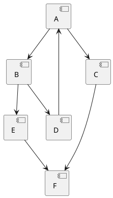

# Практическая работа №2. Инструмент визуализации графа зависимостей

**Дисциплина:** Конфигурационное управление  
**Вариант:** №23  

## 1. Общее описание
CLI-инструмент на языке Python для анализа и графической визуализации графа зависимостей пакетов Ubuntu (`apt`) без использования сторонних менеджеров пакетов. Поддерживает работу с реальными репозиториями и тестовыми графами, поиск транзитивных и обратных зависимостей с помощью нерекурсивного DFS, а также экспорт диаграмм в формат PlantUML.

## 2. Настройки и параметры (`config.ini`)
Параметры задаются в секции `[settings]` файла `config.ini`:
- `package_name` — имя анализируемого пакета.
- `repo_url` — URL-адрес файла `Packages.gz` Ubuntu или путь к тестовому файлу.
- `test_mode` — режим тестирования (`true` или `false`).
- `version` — целевая версия пакета.
- `filter_substring` — подстрока для исключения пакетов из анализа.
- `mode` — режим работы (`graph` для прямых/транзитивных связей, `reverse` для обратных).

## 3. Сборка, запуск и тестирование

### Запуск приложения
```bash
# Windows
run.bat

# Linux / macOS
chmod +x run.sh
./run.sh
```

### Запуск модульных тестов
```bash
python -m unittest discover tests
```

## 4. Примеры использования и сравнение со штатными инструментами

### Пример 1. Тестовый граф с циклами (`test_repo.txt`)
При запуске для пакета `A` с фильтром `dev` инструмент строит граф и генерирует код PlantUML:


### Пример 2. Анализ реальных пакетов (`curl`, `git`, `python3`)
При анализе пакета `curl` из репозитория Ubuntu `jammy` программа извлекает прямые и транзитивные зависимости (`libc6`, `libcurl4`, `zlib1g` и др.) и отображает PNG-схему в графическом окне.

### Сравнение со штатным `apt-cache depends`
В отличие от штатной утилиты `apt-cache depends --recurse`, наш инструмент:
1. Исключает виртуальные и альтернативные пакеты (берет первый вариант до символа `|`).
2. Применяет пользовательскую фильтрацию по подстроке (`filter_substring`) на этапе обхода графа.
3. Гарантированно обрывает циклические зависимости с помощью множества `visited` в нерекурсивном DFS.
