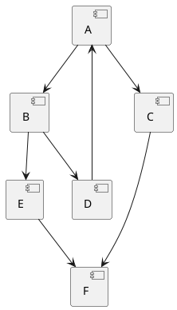

# Практическая работа №2. Инструмент визуализации графа зависимостей

**Дисциплина:** Конфигурационное управление  
**Вариант:** №23  

## 1. Общее описание
CLI-инструмент на языке Python для анализа и графической визуализации графа зависимостей пакетов Ubuntu (`apt`) без использования сторонних менеджеров пакетов. Поддерживает работу с реальными репозиториями и тестовыми графами, поиск транзитивных и обратных зависимостей с помощью нерекурсивного DFS, а также экспорт диаграмм в формат PlantUML.

### Архитектура проекта
Исходный код разбит на изолированные модули в соответствии со стандартами разработки:
- `src/config_loader.py` — загрузка и строгая валидация параметров из INI-файла.
- `src/fetcher.py` — загрузка и распаковка индексов `Packages.gz` Ubuntu (`apt`) по сети, а также парсинг текстовых графов в режиме тестирования.
- `src/graph_ops.py` — реализация нерекурсивного поиска в глубину (DFS), обнаружение и обрыв циклов, инвертирование графа для поиска обратных зависимостей.
- `src/visualizer.py` — генерация диаграмм на языке PlantUML, сжатие данных алгоритмом Deflate, кодирование URL и отрисовка полученного PNG-изображения в графическом окне `tkinter`.
- `src/main.py` — точка входа CLI-приложения, связывающая все этапы обработки.

## 2. Настройки и параметры (`config.ini`)
Параметры задаются в секции `[settings]` файла `config.ini`:
- `package_name` — имя анализируемого пакета.
- `repo_url` — URL-адрес файла `Packages.gz` Ubuntu или путь к тестовому файлу.
- `test_mode` — режим тестирования (`true` или `false`).
- `version` — целевая версия пакета.
- `filter_substring` — подстрока для исключения пакетов из анализа.
- `mode` — режим работы (`graph` для прямых/транзитивных связей, `reverse` для обратных).

### Обработка ошибок конфигурации
При запуске приложение проверяет существование файла конфигурации, наличие секции `[settings]`, заполненность обязательных полей и корректность флага `test_mode`. При обнаружении некорректных данных программа выводит понятное диагностическое сообщение и завершает работу без аварийного падения.

## 3. Сборка, запуск и тестирование

### Требования к окружению
- Python 3.10 или выше.
- Стандартная библиотека Python (`configparser`, `urllib`, `gzip`, `zlib`, `tkinter`, `unittest`). Установка сторонних пакетов через `pip` не требуется.

### Запуск приложения
```bash
# Windows
run.bat

# Linux / macOS
chmod +x run.sh
./run.sh
```

Прямой запуск через интерпретатор с передачей пути к конфигурации:
```bash
python src/main.py config.ini
```

### Запуск модульных тестов
```bash
python -m unittest discover tests
```
Набор тестов в `tests/test_main.py` проверяет парсинг INI-конфига, разбор формата пакетов `apt`, обход графа с циклами, фильтрацию по подстроке, поиск обратных зависимостей и генерацию синтаксиса PlantUML.

## 4. Примеры использования и сравнение со штатными инструментами

### Пример 1. Тестовый граф с циклами (`test_repo.txt`)
При запуске для пакета `A` с фильтром `dev` инструмент строит граф и генерирует код PlantUML:

При переключении параметра `mode = reverse` для пакета `F` программа выводит список всех пакетов, которые прямо или транзитивно зависят от него: `A, B, C, D, E`.

### Пример 2. Анализ реальных пакетов (`curl`, `git`, `python3`)
При анализе пакета `curl` из репозитория Ubuntu `jammy` программа извлекает прямые и транзитивные зависимости (`libc6`, `libcurl4`, `zlib1g` и др.) и отображает PNG-схему в графическом окне.

Демонстрация работы для трёх различных пакетов репозитория:
1. **`curl`** — выявляет цепочку сетевых и криптографических библиотек (`libcurl4`, `libssl3`, `zlib1g`, `libc6`).
2. **`git`** — строит разветвлённый граф системных утилит и библиотек (`libpcre2-8-0`, `zlib1g`, `perl`, `liberror-perl`).
3. **`python3`** — отображает базовые зависимости интерпретатора (`python3.10`, `libpython3-stdlib`, `python3-minimal`).

### Сравнение со штатным `apt-cache depends`
В отличие от штатной утилиты `apt-cache depends --recurse`, наш инструмент:
1. Исключает виртуальные и альтернативные пакеты (берет первый вариант до символа `|`).
2. Применяет пользовательскую фильтрацию по подстроке (`filter_substring`) на этапе обхода графа.
3. Гарантированно обрывает циклические зависимости с помощью множества `visited` в нерекурсивном DFS.
